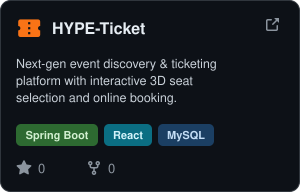
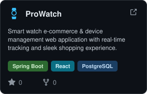
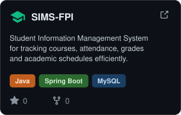

### 👋 Hi there, I'm Huu Dan!

👨🏻‍💻 Software engineering student sharing my journey and learnings in tech  
👨🏻‍🎓 Studying software engineering in Da Nang, Vietnam 

### Tech Stack

  
  
  
  
  
  
  
  
  
  
  
  
  
  
  
  
  
  
  
  
  

<h3>Featured Projects</h3>

  
  
  

<!-- <h3>My recent articles</h3>

<a href="#"><picture>
  <source media="(prefers-color-scheme: dark)" srcset="assets/article-1-dark.svg">
  <source media="(prefers-color-scheme: light)" srcset="assets/article-1-light.svg">
  
</picture></a> 
<a href="#"><picture>
  <source media="(prefers-color-scheme: dark)" srcset="assets/article-2-dark.svg">
  <source media="(prefers-color-scheme: light)" srcset="assets/article-2-light.svg">
  
</picture></a> 
<a href="#"><picture>
  <source media="(prefers-color-scheme: dark)" srcset="assets/article-3-dark.svg">
  <source media="(prefers-color-scheme: light)" srcset="assets/article-3-light.svg">
  
</picture></a> -->

### My GitHub contributions summary

<table width="100%">
  <tr>
    <td width="50%" align="center" valign="middle">
      
    </td>
    <td width="50%" align="center" valign="middle">
      
    </td>
  </tr>
</table>
